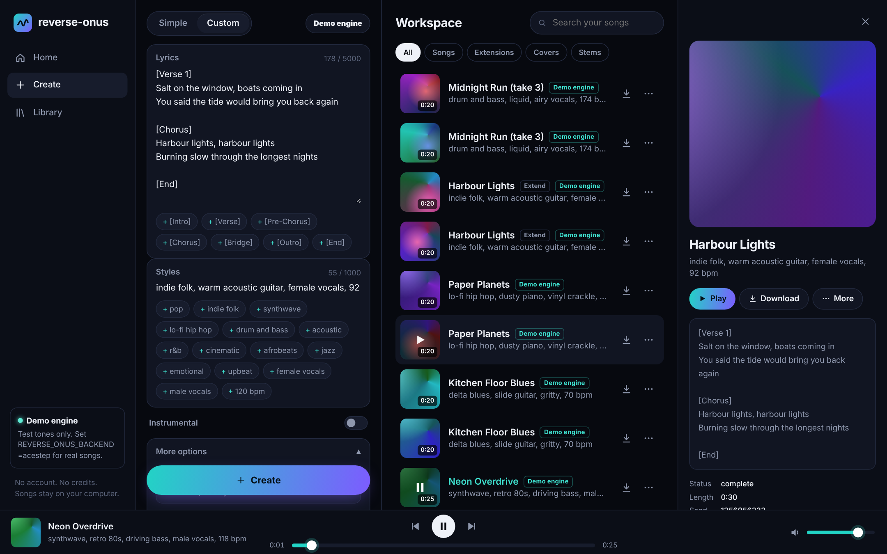

# reverse-onus

> Independent open-source project. Not affiliated with or endorsed by Suno, Inc.
> ("onus" is "suno" spelled backwards: this project reverse-engineered how Suno works.)

An open-source, Suno-style song generator: **Custom mode** (lyrics with `[Verse]`/`[Chorus]`
tags, Styles, Exclude styles, Weirdness, Style Influence, vocal gender, Instrumental),
**Simple mode** (a song description), **two takes per request**, **Extend** from any point,
**Get whole song**, **Replace Section**, **Cover** (of a clip or your own audio) and **Stems**,
behind a studio web page, an MCP connector for AI assistants (Claude Code, Claude Desktop,
Codex, ChatGPT), an HTTP API and a CLI, with an A/B harness that scores the clone against your own Suno
songs.

Why it's built this way: Suno is a transformer over audio tokens trained on a very large
(now licensed) music corpus ([docs/FINDINGS.md](docs/FINDINGS.md)). Training that from scratch
isn't realistic, and open models now come close (YuE2 tied Suno v5 in blind tests). So this
repo **rebuilds Suno's product layer on existing open models instead of training one**:
ACE-Step 1.5 by default (MIT, runs on small GPUs, supports every edit task) and YuE2 as an
optional higher-quality, generate-only engine (non-commercial weights).

## Pipeline

```
request (Suno-style fields)
  -> lyrics.parse    [Verse 1: whispered] / [Female Vocal] / [End] -> sections + descriptors
  -> style.compile   Styles + vocal gender + section notes -> caption; Exclude -> negative;
                     sliders -> temperature / guidance
  -> engine          acestep | yue2 | mock     (2 seeds per request)
       generate      text2music, or the planner LM writes lyrics in Simple mode
       extend        repaint on [clip tail + silence], keep the new part
       replace       repaint [start, end] with 15 s context either side, 2 s crossfades (as Suno)
       cover         cover task, Audio Influence -> strength
       stems         Demucs if installed, else engine extract
  -> post            trim to requested length, master.flac + loudness-normalised mp3 (-14 LUFS)
  -> clip.json + debug.json (exact engine request)
```

## Quick start

**New to this? Follow [docs/GETTING_STARTED.md](docs/GETTING_STARTED.md)**, a step-by-step guide
for Windows, Mac and Linux. No account, sign-up or domain name needed: it all runs on your computer.

The short version:

1. Start the engine, ACE-Step 1.5, on a machine with a GPU. On Windows, download its
   [portable package](https://files.acemusic.ai/acemusic/win/ACE-Step-1.5.7z) and run
   `start_api_server.bat`. Elsewhere, run
   `git clone https://github.com/ACE-Step/ACE-Step-1.5 && cd ACE-Step-1.5 && uv sync && uv run acestep-api`.
   It serves on http://localhost:8001.
2. Install reverse-onus (needs Python 3.10+, Git and ffmpeg):
   ```sh
   git clone https://github.com/CHRISTpaid/reverse-onus && cd reverse-onus
   python -m venv .venv && source .venv/bin/activate     # Windows: .venv\Scripts\activate
   pip install -e ".[mcp]"
   ```
3. Run `reverse-onus serve --engine acestep` and open http://localhost:8000.

An NVIDIA card with 8 GB+ of video memory is comfortable (ACE-Step runs in under 4 GB with
its smallest settings), and Apple Silicon Macs work too. No GPU? Rent one and point
`ACESTEP_URL` at it. Without `--engine acestep` the page runs on a test-tone demo engine.
Songs are saved in `~/ReverseOnus` (change with `REVERSE_ONUS_WORKDIR`).

## Three ways to use it

**1. Studio page.** `reverse-onus serve --engine acestep`, then open http://localhost:8000. No account or
sign-up: it runs on your machine. Custom and Simple modes, lyrics with section-tag buttons,
style chips, exclude styles, vocal gender, weirdness and style-influence sliders, two takes per
run, a searchable workspace, a song panel with lyrics, and a player bar. Each song's menu has
Extend / Cover / Replace section / Get stems / Get whole song / Reuse prompt / Download.
It works on phones too.



**2. From an AI assistant (MCP).** The assistant writes lyrics and styles from your request
and calls the tools: `create_song`, `check_songs`, `extend_song`, `replace_section`,
`cover_song`, `split_stems`, `whole_song`, `list_songs`, `check_lyrics`, `cancel_songs`.

| Assistant | Setup |
|---|---|
| Claude Code | `claude mcp add reverse-onus -e REVERSE_ONUS_BACKEND=acestep -- reverse-onus mcp` |
| Claude Desktop | in `claude_desktop_config.json`: `"mcpServers": {"reverse-onus": {"command": "reverse-onus", "args": ["mcp"], "env": {"REVERSE_ONUS_BACKEND": "acestep"}}}` |
| Codex | in `~/.codex/config.toml`: `[mcp_servers.reverse-onus]` with `command = "reverse-onus"`, `args = ["mcp"]`, `env = { REVERSE_ONUS_BACKEND = "acestep" }` |
| ChatGPT | needs a remote HTTPS server: run `reverse-onus mcp --http --port 8765`, expose it with a tunnel (e.g. `cloudflared tunnel --url http://localhost:8765`), and add `https://<tunnel>/mcp` as a custom connector in ChatGPT's developer mode |

Then ask, for example: "Write a synthwave song about driving at night, female vocals, and make
it with reverse-onus." Files are saved locally; the tools return their paths.

**3. Command line.** Add `--engine acestep` to any command (or set `REVERSE_ONUS_BACKEND=acestep`).

```sh
reverse-onus generate --style "indie pop, dreamy, female vocals" --lyrics song.txt
reverse-onus generate --describe "a sad country song about a lost dog"
reverse-onus extend <clip_id> --at 95 --lyrics verse3.txt --duration 60
reverse-onus whole <extension_clip_id>
reverse-onus replace <clip_id> --start 42 --end 58 --lyrics new-chorus.txt
reverse-onus cover <clip_id or my-demo.wav> --style "lofi jazz" --influence 0.7
reverse-onus stems <clip_id>
reverse-onus parse song.txt                   # see how the clone reads your tags
```

Tests: `pip install -e .[dev] && pytest -q` (22 tests, offline, mock engine, needs ffmpeg).

## API

```sh
reverse-onus serve --port 8000
curl -X POST localhost:8000/api/generate -H 'Content-Type: application/json' -d '{
  "style": "synthwave, male vocals", "exclude_styles": "guitar",
  "lyrics": "[Verse]\nNeon on the water\n\n[Chorus]\nWe drive all night",
  "weirdness": 0.6, "style_influence": 0.7}'
# -> {"clips":[{"id":"...","status":"queued"}, {...}]}   two takes, like Suno
curl 'localhost:8000/api/feed?ids=<id1>,<id2>'          # status, audio_url, duration, metadata
curl -X POST localhost:8000/api/extend -d '{"clip_id":"<id1>","continue_at":95,"lyrics":"[Bridge]\n..."}' -H 'Content-Type: application/json'
curl -X POST localhost:8000/api/concat -d '{"clip_id":"<extension id>"}' -H 'Content-Type: application/json'
```

`POST /api/generate/v2-web/` also takes the exact body Suno's web app sends (generate, simple,
extend, cover, replace section, stems), and `GET /api/feed/v3?ids=` returns clips in Suno's feed shape, both as
seen in captures of your own session.

Also `POST /api/replace-section`, `/api/cover`, `/api/stems`, `/api/lyrics/parse`,
`/api/clips/{id}/cancel`, `GET /files/{id}/debug.json`. `Idempotency-Key` headers are honoured.
Suno has no public API, so these routes are the clone's own; the request models also accept
the web app's field names (`tags`, `negative_tags`, `prompt`, `gpt_description_prompt`,
`make_instrumental`, `continue_clip_id`, `cover_clip_id`).

## Suno controls and what the clone does with them

| Suno | Clone | Engine (ACE-Step) |
|---|---|---|
| Styles (1,000 chars) | split into tags, deduped, plus vocal gender and per-section descriptors | `prompt`, trimmed to 512 chars |
| Exclude styles | removed from the tags, sent as the negative | `lm_negative_prompt` |
| Lyrics (5,000 chars) with meta tags | parsed into sections; `[End]` stops; voice tags apply to their section | `lyrics` with plain `[Verse]` tags |
| Instrumental | `[Instrumental]` lyrics, "instrumental" tag, "vocals" excluded | |
| Weirdness | 0..1 | `lm_temperature` 0.55..1.15 |
| Style Influence | 0..1; strong also stops the caption rewrite | `lm_cfg_scale` 1.5..3.5, `guidance_scale` 4..10 |
| Duration | optional; otherwise the planner LM picks, like Suno | `audio_duration` |
| Two songs | `variations` (default 2) | `batch_size`, fixed seeds |
| Simple mode | description only | `sample_mode` + `sample_query` |
| Audio Influence | cover strength | `audio_cover_strength` 0.2..1.0 |

Suno sends both sliders on a 0..1 scale (`metadata.control_sliders.weirdness_constraint` and
`style_weight`, from a capture of your own session), the same scale the clone uses. What they
do inside Suno's model is still a reconstruction. The A/B harness and a REA
capture of your own session ([docs/REA_CAPTURE.md](docs/REA_CAPTURE.md)) are how to correct them.

## Measuring against Suno

Suno can't be called from code, so the reference is your own Suno songs: make a few in your
account, download them, and list each with the exact prompt you used.

```sh
cat > cases.json <<'JSON'
[{"name": "synth1", "reference": "downloads/neon.mp3", "style": "synthwave, male vocals",
  "lyrics": "lyrics/neon.txt", "exclude": "guitar"}]
JSON
reverse-onus ab cases.json --out ab-runs/
reverse-onus compare clone.mp3 suno.mp3 --lyrics song.txt   # one pair
```

Each report scores tempo, key, harmony (chroma profile), length, brightness, loudness and
section count, and, with `pip install faster-whisper`, lyric word error rate for both songs.
Two Suno takes of one prompt differ too, so compare the clone's best take, and score Suno's two
takes against each other for the noise floor.

## Configuration

| Env var | Default | Meaning |
|---|---|---|
| `REVERSE_ONUS_BACKEND` | `mock` | `acestep`, `yue2`, `mock` |
| `REVERSE_ONUS_WORKDIR` | `~/ReverseOnus` | clips, audio, debug files |
| `REVERSE_ONUS_VARIATIONS` | `2` | takes per request |
| `REVERSE_ONUS_FORMAT` | `mp3` | delivery format (`mp3`, `wav`, `flac`); a lossless master is always kept |
| `REVERSE_ONUS_PUBLIC_BASE_URL` | | base for `audio_url` in API responses |
| `ACESTEP_URL`, `ACESTEP_API_KEY` | `http://localhost:8001` | ACE-Step 1.5 REST server |
| `ACESTEP_MODEL` | server default | DiT model, e.g. `acestep-v15-xl-sft` for best quality |
| `ACESTEP_BASE_MODEL` | | base DiT for engine stems (`acestep-v15-base`); not needed with Demucs |
| `ACESTEP_THINKING` | `1` | let the planner LM write metadata and audio codes |
| `YUE2_MODEL`, `YUE2_DEVICE` | `m-a-p/YuE2-3B`, `cuda` | YuE2 engine |

## Status

- Verified here: lyric parsing, style compilation, Suno field limits, the ACE-Step request
  mapping, generate / simple mode / extend / whole song / replace section / cover / stems,
  the API, the studio page, the MCP tools (stdio, MCP SDK 1.x and 2.x), idempotency and the
  scoring metrics, against the mock engine (22 passing tests).
- Run live on ACE-Step 1.5 (RTX 4090, 24 GB, Windows, turbo DiT + 1.7B LM): generate, Simple
  mode, extend, replace section and cover all work. Two takes of a song took about 26 s once
  the models were loaded; extend, replace and cover took 8 to 12 s. YuE2 hasn't been run live.
- Extend uses ACE-Step's repaint task over the clip's tail plus silence. That's a
  reconstruction of Suno's continuation; it works, but how close it sounds to Suno's still
  needs the A/B harness.
- Not built: Remaster (Suno's `chirp-halibut` upsampler), Personas/Voices, v6's plain-language section edits, mashups, image/video input.
- Licences: this project is MIT (LICENSE). ACE-Step 1.5 is MIT. YuE2 weights are CC BY-NC 4.0. Only use audio you own for
  covers and A/B references.
